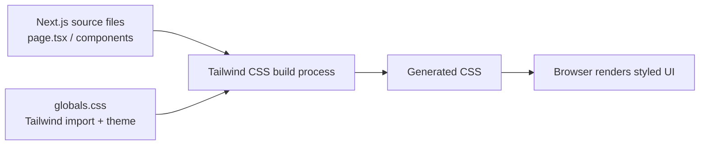

# Tailwind CSS Learning Notes

## Next.js Integration, Fundamentals, Configuration, and Tailwind CSS v3 vs v4

**Learning focus:** One-day, production-oriented Tailwind CSS learning
using Next.js  
**Progress:** Topics 1--3 partially completed. Remaining topics are
listed at the end so learning can continue later.

------------------------------------------------------------------------

## Contents

1. [Tailwind CSS fundamentals](#1-tailwind-css-fundamentals)
2. [How Tailwind works](#2-how-tailwind-works)
3. [Next.js integration with Tailwind CSS

   v4](#3-nextjs-integration-with-tailwind-css-v4)
4. [Tailwind CSS v3 vs v4](#4-tailwind-css-v3-vs-v4)
5. [Tailwind v4 CSS-first

   configuration](#5-tailwind-v4-css-first-configuration)
6. [Understanding theme namespaces](#6-understanding-theme-namespaces)
7. [Configuration examples covered so

   far](#7-configuration-examples-covered-so-far)
8. [Important doubts and

   clarifications](#8-important-doubts-and-clarifications)
9. [Interview questions and

   answers](#9-interview-questions-and-answers)
10. [Learning progress and next

    topics](#10-learning-progress-and-next-topics)

------------------------------------------------------------------------

## 1. Tailwind CSS fundamentals

### What is Tailwind CSS?

Tailwind CSS is a **utility-first CSS framework**. It provides small,
predefined utility classes that can be combined directly in HTML or JSX
to style elements.

Instead of writing a separate CSS class for every component, developers
compose utilities such as `bg-blue-600`, `p-4`, `rounded-lg`, and
`flex`.

### What does utility-first mean?

Utility-first CSS mea ns using small classes, each responsible for a  
particular styling property or purpose.

  Utility class      Purpose

  ------------------ ------------------

  `bg-blue-500`      Background color
  `text-white`       Text color
  `text-xl`          Font size
  `p-4`              Padding
  `m-4`              Margin
  `rounded-lg`       Border radius
  `flex`             `display: flex`
  `items-center`     Align items
  `justify-center`   Justify content
  `shadow-lg`        Large box shadow

### Traditional CSS vs Tailwind CSS

**Traditional CSS**

```html
<button class="primary-button">Click me</button>
```

```css
.primary-button {
  background-color: blue;
  color: white;
  padding: 12px 24px;
  border-radius: 8px;
  border: none;
}
```

**Tailwind CSS**

```html
<button class="bg-blue-600 px-6 py-3 text-white rounded-lg">
  Click me
</button>
```

Tailwind lets developers compose styling directly in markup. It can
reduce repetitive CSS authoring and help teams follow consistent styling
conventions.

### Why production projects use Tailwind

- **Development speed:** Compose styles without repeatedly creating
one-off CSS classes.
- **Consistency:** Reuse a shared spacing, color, and typography
scale.
- **Responsive design:** Use breakpoint variants such as `sm:`, `md:`,
and `lg:`.
- **State styling:** Use variants such as `hover:`, `focus:`, and
`disabled:`.
- **Customization:** Define design tokens for an application's visual
identity.
- **CSS output:** Tailwind generates CSS for detected utilities rather
than shipping every possible utility.

------------------------------------------------------------------------

## 2. How Tailwind works

The basic build flow is:

1. A developer writes Tailwind utility classes in HTML, JSX, or TSX

   files.
2. Tailwind scans the source files for class names it can detect.
3. Tailwind generates the CSS for the detected utilities.
4. The browser loads the generated CSS and applies the styles.



**Important:** Tailwind scans source as text. Build complete class names
in source code rather than constructing class names dynamically in ways
the scanner cannot detect. If a class is not detected, its CSS may not
be generated.

------------------------------------------------------------------------

## 3. Next.js integration with Tailwind CSS v4

### Create a new Next.js project

```bash
npx create-next-app@latest tailwind-learning
cd tailwind-learning
npm run dev
```

During setup, select Tailwind CSS if prompted. The project generator can
configure Tailwind automatically.

Check installed versions:

```bash
node -v
npm -v
npm list tailwindcss
```

### Typical Next.js App Router structure

```text
tailwind-learning/
├── public/
├── src/
│   └── app/
│       ├── globals.css
│       ├── layout.tsx
│       └── page.tsx
├── postcss.config.mjs
├── package.json
└── next.config.ts
```

  -----------------------------------------------------------------------

  File                                Purpose

  ----------------------------------- -----------------------------------

  `src/app/globals.css`               Tailwind import, theme definitions,
                                      global and custom CSS

  `src/app/layout.tsx`                Root layout; imports the global
                                      stylesheet

  `src/app/page.tsx`                  Home page UI

  `postcss.config.mjs`                Configures PostCSS plugins

## `package.json`                      Dependencies and project scripts

### Manual installation in an existing Next.js project

Install the Tailwind v4 packages:

```bash
npm install tailwindcss @tailwindcss/postcss postcss
```

**Important clarification:** `npm install` installs packages and updates
`package.json` and the lockfile. It does **not** automatically create
`postcss.config.mjs`.

**PostCSS as a translator.** Browsers do not natively understand Tailwind directives. PostCSS is a tool that runs during your build process to transform modern CSS features into standard CSS. [[1](https://www.google.com/goto?url=CAESdAHEIkXX5EeQqfL-BK6J2VmkM9tq_d4fyQqfu_YJCiyeBtQ3rVwT4CqyRhV-Z54eXU--B8-TFu2HjJCNiOMeLvz8rKb3wJoQaY2wDkWd3E8-cLFHgvyuIQIGib1WIyCpii62scbvgh9yvEZzLY1sJAwxcLLI)]

Create `postcss.config.mjs` manually in the project root:

```js
const config = {
  plugins: {
    "@tailwindcss/postcss": {},
  },
};

export default config;
```

Add the Tailwind import to `src/app/globals.css`:

```css
@import "tailwindcss";q
```

Import the global stylesheet from the root layout:

```tsx
import "./globals.css";

export default function RootLayout({
  children,
}: Readonly<{
  children: React.ReactNode;
}>) {
  return (
    <html lang="en">
      <body>{children}</body>
    </html>
  );
}
```

Run or restart the development server:

```bash
npm run dev
```

> If Tailwind was selected during `create-next-app`, inspect the
> generated configuration first. Do not duplicate dependencies or
> PostCSS configuration unnecessarily.

### Test the installation

```tsx
export default function Home() {
  return (
    <main className="flex min-h-screen items-center justify-center bg-gray-100">
      <div className="rounded-xl bg-white p-8 text-center shadow-lg">
        <h1 className="text-3xl font-bold text-blue-600">
          Hello Tailwind CSS!
        </h1>

        <p className="mt-3 text-gray-600">
          My first Tailwind CSS application.
        </p>

        <button className="mt-5 rounded-lg bg-blue-600 px-6 py-3 text-white transition-colors hover:bg-blue-700">
          Get started
        </button>
      </div>
    </main>
  );
}
```

If the page displays the background, spacing, typography, rounded
corners, shadow, and hover styling, Tailwind is working.

------------------------------------------------------------------------

## 4. Tailwind CSS v3 vs v4

Tailwind v4 changes the default approach from JavaScript configuration
to CSS-first configuration.

  ---------------------------------------------------------------------------

  Area                    Tailwind v3              Tailwind v4

  ----------------------- ------------------------ --------------------------

  Default configuration   JavaScript config        CSS-first configuration
  style                   (`tailwind.config.js`)   

  Main CSS entry          Three `@tailwind`        `@import "tailwindcss";`
                          directives               

  Theme customization     `theme` / `theme.extend` `@theme` in CSS
                          in JS config             

  Legacy JS config        Standard configuration   Optional; load with
                          approach                 `@config`

  PostCSS integration     Commonly `tailwindcss`   `@tailwindcss/postcss`
                          as the PostCSS plugin    

  Legacy config discovery Config conventionally    Legacy JS config is not
                          discovered by the v3     automatically detected
                      setup                    

  ---------------------------------------------------------------------------

### Tailwind v3 CSS setup

A typical v3 global stylesheet contains:

```css
@tailwind base;
@tailwind components;
@tailwind utilities;
```

These directives include Tailwind's base styles, component layer, and
utility layer.

### Tailwind v4 CSS setup

In v4, use one import:

```css
@import "tailwindcss";
```

This imports Tailwind's framework CSS, including its theme, base styles,
and utilities. The three v3 directives are not needed.

### Is `tailwind.config.js` mandatory in v4?

**No. It is optional.**

For new v4 projects, use CSS-first configuration in `globals.css`,
usually with `@theme`. A JavaScript config can still be loaded when
maintaining or migrating a project that needs legacy configuration.

### How to load a legacy JavaScript config in v4

1. Create or retain `tailwind.config.js` in the project.
2. Add the legacy configuration.
3. Load it from the CSS entry point using `@config`.

Example:

```js
// tailwind.config.js
export default {
  theme: {
    extend: {
      colors: {
        legacyBrand: "#2563eb",
      },
    },
  },
};
```

```css
/* src/app/globals.css */
@import "tailwindcss";
@config "../../tailwind.config.js";
```

The relative path above assumes `globals.css` is at
`src/app/globals.css` and the config is at the project root. Adjust it
if your project structure is different.

**Remember:** `@config` is written in the CSS entry point. It loads the
legacy config as part of Tailwind's processing; it is not imported into
a React component.

Some legacy configuration options are not supported in v4. For a new
project, prefer `@theme` and other v4 CSS-first features. When migrating
a complex v3 project, check the official Tailwind upgrade guide and
verify plugin/config compatibility.

------------------------------------------------------------------------

## 5. Tailwind v4 CSS-first configuration

### What is `@theme`?

`@theme` is a Tailwind CSS at-rule used to define theme variables, also
known as design tokens. Tailwind recognizes specific theme namespaces
and generates corresponding utility classes and variants.

Example:

```css
@import "tailwindcss";

@theme {
 -primary --color: #2563eb;
  --color-secondary: #16a34a;

  --font-display: "Inter", sans-serif;

  --breakpoint-3xl: 120rem;
}
```

### Why use theme tokens?

Theme tokens centralize design decisions. If the brand color changes,
update the token once instead of changing the same hard-coded color
across many components.

For example:

```css
@theme {
  --color-primary: #9333ea;
}
```

Utilities that use `bg-primary` now use the updated value.

------------------------------------------------------------------------

## 6. Understanding theme namespaces

Consider this declaration:

```css
--color-primary: #2563eb;
```

It has three meaningful parts:

  Part         Meaning

  ------------ --------------------------------------------------

  `--color-`   Theme namespace; identifies the token as a color
  `primary`    Custom token name chosen by the developer
  `#2563eb`    Actual color value

The complete CSS custom property name is `--color-primary`.

Because it uses the `--color-` namespace, Tailwind can generate color
utilities from it.

  -----------------------------------------------------------------------

  Theme variable                      Example utility classes

  ----------------------------------- -----------------------------------

  `--color-primary`                   `bg-primary`, `text-primary`,
                                      `border-primary`

  `--color-secondary`                 `bg-secondary`, `text-secondary`,
                                      `border-secondary`

  `--font-display`                    `font-display`

## `--breakpoint-3xl`                  `3xl:` responsive variant

Example JSX:

```tsx
<div className="bg-primary text-white">
  Hello Tailwind!
</div>
```

Tailwind applies the `#2563eb` color as the background.

**Key takeaway:**

- `--color-` = namespace / token type.
- `primary` = custom token name.
- `#2563eb` = token value.

------------------------------------------------------------------------

## 7. Configuration examples covered so far

These examples introduce the main configuration concepts. Some will be
explored in more detail in the next learning session.

### Custom colors

```css
@theme {
  --color-primary: #2563eb;
  --color-secondary: #16a34a;
}
```

Usage:

```tsx
<div className="bg-primary text-white">Primary panel</div>
<p className="text-secondary">Success message</p>
```

### Custom fonts

```css
@theme {
  --font-display: "Inter", sans-serif;
}
```

Usage:

```tsx
<h1 className="font-display">Welcome</h1>
```

The font must also be loaded by the application. Defining the token
alone does not download the font. In Next.js, consider using `next/font`
for production font loading.

### Custom breakpoints

```css
@theme {
  --breakpoint-3xl: 120rem;
}
```

Usage:

```tsx
<div className="bg-blue-500 3xl:bg-purple-500">
  Responsive content
</div>
```

The `3xl:` variant applies at the configured breakpoint and above.

### Spacing scale

Tailwind provides a default spacing scale used by utilities such as
`p-4`, `mt-4`, and `gap-4`.

The base spacing theme variable can be customized:

```css
@theme {
  --spacing: 4px;
}
```

With this scale, `p-5` corresponds to `20px` (5 × 4px).

> This changes the spacing scale globally. It can affect many spacing
> utilities, so do not change it casually in an existing production
> application. We will study safer customization patterns later.

------------------------------------------------------------------------

## 8. Important doubts and clarifications

### Doubt 2: Is `tailwind.config.js` only for v3?

It is the standard configuration approach in v3. In v4 it is still
supported for compatibility, but it is optional and is not automatically
detected. Load it using `@config` from the CSS entry point.

### Doubt 3: Can v4 use `tailwind.config.js` and `@theme` together?

Yes. A v4 project can load a legacy JS config with `@config` and also
define CSS-first theme tokens using `@theme`. Be careful about duplicate
or conflicting token definitions, and remember that not every legacy
option is supported in v4.

### Doubt 4: Do we need the three `@tailwind` directives in v4?

No. The v3 setup commonly used:

```css
@tailwind base;
@tailwind components;
@tailwind utilities;
```

The v4 setup uses:

```css
@import "tailwindcss";
```

### Doubt 5: Is `@theme` a directive?

It is an at-rule provided by Tailwind CSS. It is used to define theme
variables that participate in Tailwind's theme system.

### Doubt 6: What is the difference between the namespace and the token name?

In `--color-primary`, `--color-` is the namespace and `primary` is the
custom token name. The value after the colon is the actual color.

### Doubt 7: Do all component styles need to be written in `globals.css`?

No. `globals.css` is useful for the Tailwind import, theme tokens,
global styles, and custom CSS. Most component styling can be written
with utility classes directly in JSX/TSX.

### Doubt 8: Are CSS directives the same as decorators?

No. In CSS, constructs such as `@import`, `@theme`, and `@tailwind` are
called **at-rules**. They are not JavaScript/TypeScript decorators.

### Doubt 9: Does defining a custom font token load the font?

No. The token tells Tailwind which font family to use when generating
the utility. The font itself must be available to the browser, for
example through Next.js `next/font` or a suitable font stylesheet.

------------------------------------------------------------------------

## 9. Interview questions and answers

### Q1. What is Tailwind CSS?

Tailwind CSS is a utility-first CSS framework that allows developers to
style HTML and JSX using small, composable utility classes.

### Q2. What is utility-first CSS?

It is an approach where small utility classes are combined directly in
markup to build a design instead of creating a separate CSS class for
every component.

### Q3. What is the difference between Bootstrap and Tailwind CSS?

Bootstrap provides predefined UI components and styling conventions.
Tailwind provides low-level utility classes that developers combine to
build custom interfaces.

### Q4. How does Tailwind generate CSS?

Tailwind scans project source files for detectable class names and
generates CSS for the utilities it finds.

### Q5. How do you integrate Tailwind v4 with Next.js?

Install `tailwindcss`, `@tailwindcss/postcss`, and `postcss`; configure
the PostCSS plugin in `postcss.config.mjs`; add `@import "tailwindcss";`
to the global stylesheet; and import that stylesheet in the root layout.

### Q6. Does `npm install` generate `postcss.config.mjs`?

No. Installing packages updates dependencies and package metadata. The
PostCSS config file must be created separately unless the project
generator has already created it.

### Q7. What is the purpose of `globals.css`?

It is the global stylesheet entry point. It can contain Tailwind
imports, theme definitions, global CSS, and custom styles.

### Q8. What is the purpose of `tailwind.config.js`?

In v3, it is the standard JavaScript configuration file for content
paths, theme customization, plugins, and other settings. In v4, it is
optional and can be loaded for legacy compatibility using `@config`.

### Q9. Is `tailwind.config.js` mandatory in v4?

No. Tailwind v4 uses CSS-first configuration by default. Developers can
define theme values directly in CSS using `@theme`.

### Q10. What is `@theme`?

`@theme` is a Tailwind CSS at-rule for defining theme variables such as
colors, fonts, and breakpoints. Recognized namespaces allow Tailwind to
generate corresponding utility classes and variants.

### Q11. What is the difference between `@theme` and normal CSS variables?

Normal CSS variables declared in `:root` are ordinary CSS custom
properties. Theme variables declared in `@theme` participate in
Tailwind's theme system and can generate utility classes when they use
recognized namespaces.

### Q12. What are theme namespaces?

Theme namespaces are naming conventions such as `--color-*`, `--font-*`,
and `--breakpoint-*`. They tell Tailwind what kind of design token is
being defined.

### Q13. Can we use `tailwind.config.js` and `@theme` together in v4?

Yes. Load the legacy JavaScript configuration using `@config` in the CSS
entry point, and define additional CSS-first theme values using
`@theme`. Check for overlapping tokens and legacy options that may not
be supported in v4.

### Q14. What is the difference between Tailwind v3 and v4 CSS setup?

V3 commonly uses three directives: `@tailwind base`,
`@tailwind components`, and `@tailwind utilities`. V4 uses a single
`@import "tailwindcss";` statement.

### Q15. What is the difference between `@theme` and `:root`?

`:root` defines ordinary CSS custom properties. `@theme` defines
Tailwind theme variables; recognized namespaces also let Tailwind
generate matching utility classes and variants.

------------------------------------------------------------------------

## 10. Learning progress and next topics

### Completed

- [x] Tailwind CSS fundamentals
- [x] Utility-first CSS
- [x] Traditional CSS vs Tailwind CSS
- [x] Tailwind's source scanning and CSS generation flow
- [x] Next.js integration basics
- [x] Manual Tailwind v4 installation
- [x] PostCSS configuration
- [x] `globals.css` and root layout integration
- [x] Tailwind v3 vs v4 fundamentals
- [x] `tailwind.config.js` in v4: optional and loaded using `@config`
- [x] Introduction to `@theme`
- [x] Theme namespaces, custom token names, and values
- [x] Introduction to custom colors, fonts, spacing, and breakpoints

### Remaining topics

- [ ] `@theme` vs `:root` in depth
- [ ] Custom colors, fonts, spacing, and breakpoints in depth
- [ ] Core utilities: sizing, spacing, Flexbox, and Grid
- [ ] Responsive design and mobile-first breakpoints
- [ ] Hover, focus, active, disabled, and group variants
- [ ] Dark mode
- [ ] Transitions and transforms
- [ ] Custom keyframe animations
- [ ] Reusable component styling patterns
- [ ] Production best practices and optimization
- [ ] Practical UI implementation
- [ ] Final interview revision

------------------------------------------------------------------------

## Reference

- Tailwind CSS documentation: https://tailwindcss.com/docs
- Tailwind CSS v4 upgrade guide:
https://tailwindcss.com/docs/upgrade-guide
- Next.js documentation: https://nextjs.org/docs

> **Note:** Tailwind CSS APIs and setup instructions can change between
> releases. Check the documentation for the exact version installed in
> the project, especially when migrating from v3 to v4.
